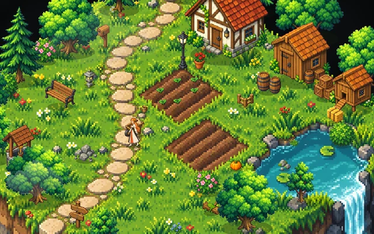

# Pixel Pet 小游戏

[Pixel Pet Affection](https://github.com/rdmclin2/lobehub-pixel-pet-affection) 桌宠的小游戏源码。在应用的 **⚙ 设置 → 商店 → 小游戏** 里下载，桌宠会进到游戏里，和你一起玩。

| 游戏 | 版本 | 说明 |
| --- | --- | --- |
| [像素小院](games/pixel-yard) | 见 [`catalog.json`](catalog.json) | 一座漂在空中的等距像素小院：她自己逛、种菜、摘浆果、抓萤火虫；时段和天气可调；每天三件小事，完成加好感 |



## 一个小游戏由什么组成

小游戏包**只有图片和配置**（`manifest.json`、`sprites.json`、`.webp` / `.png`），由应用内置的引擎来玩，下载下来的东西不会被当作代码运行。格式说明见应用仓库的 [`docs/mini-games.md`](https://github.com/rdmclin2/lobehub-pixel-pet-affection/blob/canary/docs/mini-games.md)，校验规则是 [`tools/game-pack.js`](tools/game-pack.js)（应用 `src/core/game-pack.js` 的副本）。

```
games/<id>/
  pack/            安装包里的全部内容：manifest.json（地图、物件、互动、每日小事、台词）、sprites.json、terrain.webp、atlas.webp
  art/             美术源：prompts.json（GPT Image 提示词）、layout.json（切图排布）、raw/（原图，无损 WebP）
  cover.webp       商店卡片的封面
  store.json       商店卡片上的玩法要点
  CHANGELOG.md     每个版本的更新说明（商店的「有更新」里显示最新一节）
catalog.json       商店目录：应用从这里得知有哪些游戏、最新版本、安装包大小和 sha256
scripts/           build.js（打包）· publish.js（上传 CDN）· game_sprites.py（切图）· generate.sh（生成原图）
tools/game-pack.js 小游戏包格式校验（与应用一致）
```

## 改游戏、发新版本

1. 改 `games/<id>/pack/manifest.json`：物件位置、可走区域、互动、每日小事、台词……；换美术就改 `art/` 后重新切图：
   ```bash
   python3 scripts/game_sprites.py build games/pixel-yard/art/layout.json games/pixel-yard/art/raw games/pixel-yard/pack
   ```
   在应用里试玩：把应用仓库的 `catalog/games/<id>` 指向这里的 `pack/`（或复制过去），用 `PIXELPET_DEV_GAMES=1 npm start` 启动。
2. **升版本号**：`manifest.json` 的 `version`（x.y.z），并在 `CHANGELOG.md` 顶部加一节 `## x.y.z · 日期`。已经发布的版本内容不能再改，`build.js` 会拦下。
3. 打包、上传、上架：
   ```bash
   node scripts/build.js            # 校验 + 打包 out/<id>-<version>.zip + 更新 catalog.json
   node scripts/publish.js          # 传到 CDN，下载回来比对，标记 published
   git commit -am "🔖 pixel-yard 1.1.0" && git push
   ```
   推送后，已安装的应用打开商店（或每 6 小时一次）会读到新的 `catalog.json`：商店卡片显示「有更新 1.1.0」和更新说明，游戏窗口里也会提示；点「更新」下载新包替换旧包，进度（今日小事、菜地等）保留。
4. 新游戏：在 `games/` 下新建一个目录，结构同上，`id` 用小写字母、数字和 `-`。

需要新的玩法（引擎做不到的事）时，要先在应用里加新的引擎版本（`engine: "yard@2"`），应用发版后再发用到它的游戏包。应用不支持的引擎，商店会显示「需要先更新应用」；也可以在 `store.json` 写 `minAppVersion`。

## 美术

美术由 GPT Image（gpt-image-2.5）生成：`scripts/generate.sh games/pixel-yard` 按 `art/prompts.json` 一张张生成（需要已登录的 `lh`），`scripts/game_sprites.py find <原图>` 列出图上的精灵，`layout.json` 给它们命名、定框和缩放，`build` 切图打图集。Python 脚本需要 Pillow 和 numpy。

## 许可

MIT（见 [LICENSE](LICENSE)）。美术是 AI 生成的原创图，不来自任何现有游戏。
